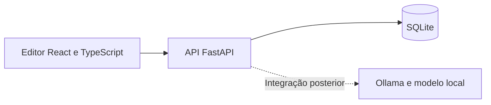

# Editor: desenho e contrato

Contrato dos incrementos 5A e 5B do [planeamento](planeamento.md), implementados em `frontend/` e `backend/`. Inclui estados, exportação JSON e gravação automática. As instruções de execução e verificação estão no [README](../README.md). Os exemplos de texto e datas são ilustrativos.

## Percurso e esboço do ecrã

```text
Exercício: Oficina de tradução                 EN → PT-PT
Instruções: Traduz as informações para os participantes.

Segmentos             Original
[1] Selecionado       The workshop starts at 10:30.
[2]                   Tradução
[3]                   ┌─────────────────────────────────────┐
                      │ A oficina começa às 10:30.           │
                      └─────────────────────────────────────┘
                      Alterações por guardar     [Guardar]
```

O campo de tradução tem um rótulo visível, pode ser usado por teclado e mantém acentos, pontuação, espaços e quebras de linha. O estado de gravação é comunicado por texto, não apenas por cor.

1. Abrir o projeto e selecionar um segmento.
2. Editar a tradução localmente; o estado passa a «Alterações por guardar».
3. Aguardar 1 segundo sem alterações ou clicar em Guardar; mostrar «A guardar» enquanto a API responde.
4. Após confirmação, apresentar «Guardado». Se o utilizador entretanto escreveu mais, manter «Alterações por guardar» para o texto novo.
5. Ao mudar de segmento com alterações pendentes, permitir guardar, descartar ou cancelar a navegação. Não perder texto silenciosamente.
6. Em caso de erro, conservar o rascunho e permitir nova tentativa. Recarregar com alterações não guardadas pode perdê-las: a recuperação garantida neste incremento aplica-se ao que a API confirmou como guardado.

Não mostrar botões simulados de QA, LLM ou memória neste primeiro ecrã. Aguardar a implementação real de cada funcionalidade.

## Arquitetura



A execução é nativa e local, com dependências fixadas em `backend/requirements.txt` e `frontend/package-lock.json`. O serviço do modelo será separado da API. Não é necessário Docker para verificar o primeiro percurso. Não publicar a instalação de desenvolvimento na Internet.

## Dados mínimos

| Entidade | Campos | Regra |
| --- | --- | --- |
| Projeto | `id`, `title`, `instructions`, `source_language`, `target_language` | Metadados fixos do exercício inicial. |
| Segmento | `id`, `project_id`, `position`, `source_text`, `current_revision` | Identificador estável; posição única dentro do projeto. |
| Revisão | `segment_id`, `revision`, `target_text`, `status`, `saved_at` | Chave composta `(segment_id, revision)`; versões imutáveis de texto e estado. |

Criar a revisão inicial `0` com tradução vazia e estado `untranslated`. As versões seguintes são sequenciais por segmento e usam data/hora UTC atribuída pelo servidor. `current_revision` aponta para a revisão confirmada; não duplicar a tradução nem o estado atual noutras colunas da base de dados.

Guardar a nova revisão e atualizar o apontador na mesma transação. Ativar e verificar as restrições de integridade referencial do SQLite na implementação. SQLite por si só não fornece isolamento entre utilizadores.

Uma gravação sem alterações de texto nem estado não cria uma revisão. Aceitar tradução vazia ou só com espaços, exceto para marcar como concluído: o armazenamento preserva o texto; o QA posterior identifica a ausência de tradução.

Eventos e feedback serão adicionados nos incrementos seguintes. O feedback deverá referenciar `(segment_id, revision)`, não apenas o segmento.

## Estados dos segmentos (primeira parte de 5B)

| Valor na API | Rótulo | Comportamento |
| --- | --- | --- |
| `untranslated` | Por traduzir | Estado inicial; aplicado pelo editor quando o texto fica vazio ou só com espaços. Também pode ser escolhido manualmente sem apagar o texto. |
| `in_review` | Em revisão | Aplicado pelo editor quando se escreve ou altera texto não vazio. Pode ser escolhido manualmente, incluindo para reabrir um segmento concluído. |
| `completed` | Concluído | Escolha explícita do estudante; exige texto não vazio. Não representa uma avaliação automática da qualidade. |

As transições manuais são livres, com a restrição de não concluir texto vazio/só com espaços (`422`, código `invalid_status`). Editar um rascunho concluído coloca-o novamente em revisão, ou por traduzir se ficar vazio. O estudante pode voltar a escolher concluído antes de guardar.

Texto e estado são um único rascunho: escolher um estado agenda a gravação automática; **Guardar** antecipa esse pedido. Ambos são persistidos numa nova revisão, mesmo quando só o estado muda. A saída, navegação, recuperação de falhas e comparação de conflitos consideram os dois campos. O estado mostrado na lista inclui «Por guardar» quando existe uma alteração local.

O pedido aceita `status` omitido ou `null` para compatibilidade com clientes 5A: se o texto não mudar, mantém o estado persistido; se mudar, infere `in_review` ou `untranslated` a partir do texto. O frontend atual envia sempre o estado explicitamente. A API valida os três valores possíveis e o SQLite também restringe os valores da coluna.

Na primeira abertura de uma base de dados 5A, o backend acrescenta `revisions.status` e preenche as revisões antigas com `untranslated` para texto vazio/só com espaços ou `in_review` para texto não vazio. A inferência não declara que o estudante atribuiu esses estados no passado. A migração é transacional, preserva os restantes campos e não volta a ser aplicada no arranque seguinte.

## Dados de demonstração

O backend cria uma única vez este exercício se ainda não existir. Reiniciar não repõe traduções nem duplica segmentos.

`GET /api/projects/1` → `200`

```json
{
  "id": 1,
  "title": "Oficina de tradução",
  "instructions": "Traduz as informações para os participantes.",
  "source_language": "en",
  "target_language": "pt-PT",
  "segments": [
    {"id": 1, "position": 1, "source_text": "The workshop starts at 10:30.", "target_text": "", "status": "untranslated", "revision": 0},
    {"id": 2, "position": 2, "source_text": "Bring a notebook.", "target_text": "", "status": "untranslated", "revision": 0},
    {"id": 3, "position": 3, "source_text": "The session lasts 45 minutes.", "target_text": "", "status": "untranslated", "revision": 0}
  ]
}
```

Não criar já um sistema de gestão de exercícios. Estes três segmentos são dados de demonstração e não pertencem ao futuro conjunto de teste científico.

## Contrato de gravação

`PUT /api/projects/1/segments/1`

```json
{
  "target_text": "A oficina começa às 10:30.",
  "status": "in_review",
  "base_revision": 0
}
```

Resposta `200`:

```json
{
  "id": 1,
  "target_text": "A oficina começa às 10:30.",
  "status": "in_review",
  "revision": 1,
  "saved_at": "2026-10-20T10:00:00Z"
}
```

Validar o corpo, a existência do projeto/segmento e a pertença do segmento ao projeto. O cliente não escolhe o número da nova revisão nem a data.

| Situação | Resposta e comportamento |
| --- | --- |
| Corpo inválido | `422`; preservar rascunho. |
| Projeto/segmento inexistente ou associação errada | `404`. |
| `base_revision` diferente da revisão atual | `409` com código `revision_conflict`; apresentar conflito e conservar o rascunho. |
| Texto e estado iguais aos atuais e revisão de base atual | `200` com a revisão existente; não criar duplicados. |
| Falha de persistência | `500` com código `save_failed`, sem detalhes internos; transação revertida e rascunho mantido no cliente. |

A verificação de `base_revision` e a atualização têm de ser atómicas. Mesmo num protótipo local, duas abas ou dois pedidos podem tentar guardar a partir da mesma revisão.

Se a ligação falhar depois de a escrita ter sido concluída, o cliente não sabe se guardou. Voltar a ler o projeto: se o texto e estado persistidos corresponderem aos enviados, confirmar a gravação. Se existir uma revisão diferente com outro texto ou estado, apresentar conflito; se a revisão de base se mantiver, permitir nova tentativa. Não sobrescrever automaticamente uma revisão mais recente.

No cliente, permitir no máximo um pedido de gravação pendente por segmento. Quando chegar uma resposta, comparar texto e estado do rascunho atual com os enviados antes de indicar «Guardado».

## Exportação JSON (segunda parte de 5B)

`GET /api/projects/1/export` → `200`, `Content-Type: application/json`, `Content-Disposition: attachment; filename="exercicio-1.json"`, `Cache-Control: no-store`.

```json
{
  "format_version": 1,
  "project": {
    "id": 1,
    "title": "Oficina de tradução",
    "instructions": "Traduz as informações para os participantes.",
    "source_language": "en",
    "target_language": "pt-PT",
    "segments": [
      {"id": 1, "position": 1, "source_text": "The workshop starts at 10:30.", "target_text": "A oficina começa às 10:30.", "status": "completed", "revision": 2},
      {"id": 2, "position": 2, "source_text": "Bring a notebook.", "target_text": "", "status": "untranslated", "revision": 0},
      {"id": 3, "position": 3, "source_text": "The session lasts 45 minutes.", "target_text": "", "status": "untranslated", "revision": 0}
    ]
  }
}
```

`format_version` é um inteiro que identifica a estrutura do ficheiro, independente do número da revisão de cada segmento. Na versão 1, `project` tem os mesmos campos da leitura do exercício. Exportar inclui todos os segmentos, mesmo vazios ou ainda não concluídos, por ordem de posição, com a revisão atual. Não inclui o histórico completo nem rascunhos locais. A importação será implementada posteriormente.

A API reutiliza a leitura transacional do exercício: o ficheiro reflete um estado consistente da base de dados, sem alterar textos, estados, datas ou revisões. Não há alterações de esquema nem novas dependências. Exercício inexistente produz `404` (`not_found`); erro de leitura produz `500` (`export_failed`), sem cabeçalho de download.

O frontend pede sempre os dados à API ao exportar, incluindo gravações feitas noutras abas, e não substitui o conteúdo do editor pelo ficheiro. Gera um JSON UTF-8 legível com as APIs nativas `Blob` e `URL.createObjectURL`, usa `exercicio-{id}.json` e liberta o URL temporário após iniciar o download.

Alterações pendentes de texto ou estado impedem a exportação: o editor pede para guardar e voltar a clicar em **Exportar exercício**. Também bloqueia durante gravações, conflitos ou gravações por confirmar. Durante a leitura para exportação, desativa temporariamente edição, navegação e novos pedidos. Uma falha não apaga o trabalho nem gera um ficheiro de erro; permite repetir a exportação.

## Gravação automática (terceira parte de 5B)

O frontend agenda o mesmo `PUT` da gravação manual para 1000 ms após a última edição de texto ou estado. A indicação **Guardado** depende da confirmação da API, não apenas do tempo decorrido. Não há novos endpoints, migrações nem dependências.

O temporizador só funciona com alterações pendentes, sem erro/conflito, sem pedido em curso e fora do diálogo de navegação e da exportação. É cancelado/reavaliado em cada render e ao desmontar o editor. O prazo usa a data da última edição, pelo que uma mensagem de exportação ou a resposta de um pedido não reinicia o intervalo.

Enquanto um pedido está pendente, o rascunho continua editável. Depois da resposta, o editor atualiza a revisão de base e compara texto e estado. Se houver novas alterações, agenda apenas o rascunho mais recente: espera pelo tempo restante do intervalo ou envia logo que o pedido anterior termine, caso o intervalo já tenha passado. Nunca mantém uma fila com versões intermédias nem dois pedidos de gravação em simultâneo.

**Guardar** envia imediatamente e cancela o temporizador pendente. Abrir o exercício ou reverter todas as alterações antes do prazo não provoca escrita. O diálogo de navegação suspende a gravação automática: descartar cancela o rascunho, guardar envia uma vez antes de mudar, e continuar a editar retoma o temporizador se não existir uma pausa por erro.

Após falha de persistência ou gravação não confirmada, a gravação automática fica suspensa e o rascunho permanece disponível. Novas edições não desencadeiam tentativas repetidas. Uma gravação manual bem-sucedida ou a confirmação da gravação anterior pela API permite retomar. Se a leitura de confirmação também falhar, **Verificar gravação** continua a ser uma ação apenas de leitura; novas edições só são enviadas depois de conhecer a versão persistida.

Uma gravação com conflito nunca é repetida automaticamente sobre a nova revisão. **Manter o meu rascunho** atualiza a revisão de base, mas mantém a pausa até **Guardar** ser escolhido explicitamente. **Usar versão guardada** substitui o rascunho por escolha do utilizador e permite gravação automática das edições seguintes.

Antes de sair, o aviso do navegador continua ativo para alterações ou pedidos pendentes. Não se tenta enviar uma gravação adicional ao fechar a página nem se promete recuperar rascunhos após o fecho. A exportação continua a exigir uma gravação confirmada.

## Aceitação do incremento 5A

- Os três segmentos aparecem na ordem definida; selecionar e editar funciona com teclado.
- Guardar texto com acentos, aspas, quebras de linha e espaços preserva exatamente o conteúdo.
- Recarregar o browser e reiniciar o backend recupera o texto guardado.
- Falhar uma gravação não altera a versão persistida nem limpa o rascunho.
- Uma gravação sem alterações não cria outra revisão.
- Uma revisão de base antiga produz conflito; um segmento de outro projeto não pode ser alterado por este URL.
- Uma resposta antiga não marca como guardado texto escrito depois do pedido.

Os testes em `backend/tests/test_editor.py` verificam a API com SQLite, incluindo reinício, concorrência e reversão de transações. Os testes em `frontend/src/App.test.tsx` verificam as interações do editor com respostas simuladas da API, incluindo conflitos e falhas de ligação. `frontend/src/App.autosave.test.tsx` usa temporizadores controlados e React StrictMode para verificar o intervalo, pedidos atrasados, pausa/retoma, navegação, exportação e cancelamento ao desmontar. A revisão visual e do comportamento nativo do navegador deve seguir o roteiro no README.

Na persistência, a reserva de escrita do SQLite (`BEGIN IMMEDIATE`) é adquirida antes de verificar a revisão; assim, dois pedidos não podem guardar a partir da mesma versão. As chaves estrangeiras ficam ativas em todas as ligações. A revisão inicial e o segmento são criados na mesma transação, com a referência à revisão validada no final.

Quando não é possível confirmar uma gravação, o editor conserva o rascunho e disponibiliza **Verificar gravação**. Só permite um novo envio depois de conhecer a versão persistida. Num conflito, **Manter o meu rascunho** atualiza a revisão de base, mas exige um novo clique em Guardar; **Usar versão guardada** substitui o rascunho apenas por escolha explícita.
