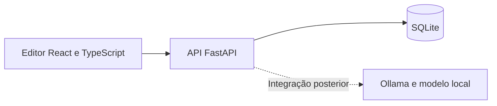

# Editor: desenho e contrato do primeiro incremento

Especificação proposta, ainda sem implementação. Corresponde ao incremento 5A do [planeamento](planeamento.md). Os identificadores dos exemplos são ilustrativos.

## Percurso e esboço do ecrã

```text
Exercício: Oficina de tradução                 EN → PT-PT
Instruções: Traduz as informações para os participantes.

Segmentos             Original
[1] Selecionado       The workshop starts at 10:30.
[2]                   Tradução
[3]                   ┌─────────────────────────────────────┐
                      │ A oficina começa às 10:30.           │
                      └─────────────────────────────────────┘
                      Alterações por guardar     [Guardar]
```

O campo de tradução tem um rótulo visível, pode ser usado por teclado e mantém acentos, pontuação, espaços e quebras de linha. O estado de gravação é comunicado por texto, não apenas por cor.

1. Abrir o projeto e selecionar um segmento.
2. Editar a tradução localmente; o estado passa a «Alterações por guardar».
3. Clicar em Guardar; mostrar «A guardar» enquanto a API responde.
4. Após confirmação, apresentar «Guardado». Se o utilizador entretanto escreveu mais, manter «Alterações por guardar» para o texto novo.
5. Ao mudar de segmento com alterações pendentes, permitir guardar, descartar ou cancelar a navegação. Não perder texto silenciosamente.
6. Em caso de erro, conservar o rascunho e permitir nova tentativa. Recarregar com alterações não guardadas pode perdê-las: a recuperação garantida neste incremento aplica-se ao que a API confirmou como guardado.

Não mostrar botões simulados de QA, LLM ou memória neste primeiro ecrã. Aguardar a implementação real de cada funcionalidade.

## Arquitetura proposta



Começar com execução nativa local e dependências fixadas quando forem instaladas. O serviço do modelo é separado da API. Não é necessário Docker para verificar o primeiro percurso. Não publicar a instalação de desenvolvimento na Internet.

## Dados mínimos

| Entidade | Campos | Regra |
| --- | --- | --- |
| Projeto | `id`, `title`, `instructions`, `source_language`, `target_language` | Metadados fixos do exercício inicial. |
| Segmento | `id`, `project_id`, `position`, `source_text`, `current_revision` | Identificador estável; posição única dentro do projeto. |
| Revisão | `segment_id`, `revision`, `target_text`, `saved_at` | Chave composta `(segment_id, revision)`; versões imutáveis. |

Criar a revisão inicial `0` com tradução vazia. As versões seguintes são sequenciais por segmento e usam data/hora UTC atribuída pelo servidor. `current_revision` aponta para a revisão confirmada; não duplicar a tradução atual em duas colunas da base de dados.

Guardar a nova revisão e atualizar o apontador na mesma transação. Ativar e verificar as restrições de integridade referencial do SQLite na implementação. SQLite por si só não fornece isolamento entre utilizadores.

Uma gravação sem alterações não cria uma revisão. Aceitar tradução vazia ou só com espaços: o armazenamento preserva o texto; o QA posterior identifica a ausência de tradução.

Estados pedagógicos, eventos e feedback serão adicionados nos incrementos seguintes. O feedback deverá referenciar `(segment_id, revision)`, não apenas o segmento.

## Dados de demonstração

O backend poderá criar uma única vez este exercício se ainda não existir. Reiniciar não deve repor traduções nem duplicar segmentos.

`GET /api/projects/1` → `200`

```json
{
  "id": 1,
  "title": "Oficina de tradução",
  "instructions": "Traduz as informações para os participantes.",
  "source_language": "en",
  "target_language": "pt-PT",
  "segments": [
    {"id": 1, "position": 1, "source_text": "The workshop starts at 10:30.", "target_text": "", "revision": 0},
    {"id": 2, "position": 2, "source_text": "Bring a notebook.", "target_text": "", "revision": 0},
    {"id": 3, "position": 3, "source_text": "The session lasts 45 minutes.", "target_text": "", "revision": 0}
  ]
}
```

Não criar já um sistema de gestão de exercícios. Estes três segmentos são dados de demonstração e não pertencem ao futuro conjunto de teste científico.

## Contrato de gravação

`PUT /api/projects/1/segments/1`

```json
{
  "target_text": "A oficina começa às 10:30.",
  "base_revision": 0
}
```

Resposta `200`:

```json
{
  "id": 1,
  "target_text": "A oficina começa às 10:30.",
  "revision": 1,
  "saved_at": "2026-10-20T10:00:00Z"
}
```

Validar o corpo, a existência do projeto/segmento e a pertença do segmento ao projeto. O cliente não escolhe o número da nova revisão nem a data.

| Situação | Resposta e comportamento |
| --- | --- |
| Corpo inválido | `422`; preservar rascunho. |
| Projeto/segmento inexistente ou associação errada | `404`. |
| `base_revision` diferente da revisão atual | `409` com código `revision_conflict`; apresentar conflito e conservar o rascunho. |
| Texto igual ao atual e revisão de base atual | `200` com a revisão existente; não criar duplicados. |
| Falha de persistência | `500` com código `save_failed`, sem detalhes internos; transação revertida e rascunho mantido no cliente. |

A verificação de `base_revision` e a atualização têm de ser atómicas. Mesmo num protótipo local, duas abas ou dois pedidos podem tentar guardar a partir da mesma revisão.

Se a ligação falhar depois de a escrita ter sido concluída, o cliente não sabe se guardou. Voltar a ler o projeto: se a tradução persistida corresponder ao texto enviado, confirmar o estado; caso contrário, apresentar o conflito. Não sobrescrever automaticamente uma revisão mais recente.

No cliente, permitir no máximo um pedido de gravação pendente por segmento. Quando chegar uma resposta, comparar o rascunho atual com o texto enviado antes de indicar «Guardado».

## Aceitação do incremento 5A

- Os três segmentos aparecem na ordem definida; selecionar e editar funciona com teclado.
- Guardar texto com acentos, aspas, quebras de linha e espaços preserva exatamente o conteúdo.
- Recarregar o browser e reiniciar o backend recupera o texto guardado.
- Falhar uma gravação não altera a versão persistida nem limpa o rascunho.
- Uma gravação sem alterações não cria outra revisão.
- Uma revisão de base antiga produz conflito; um segmento de outro projeto não pode ser alterado por este URL.
- Uma resposta antiga não marca como guardado texto escrito depois do pedido.

Estes são critérios para futuros testes de integração e do percurso do editor. Não existem endpoints ou testes implementados nesta etapa.
